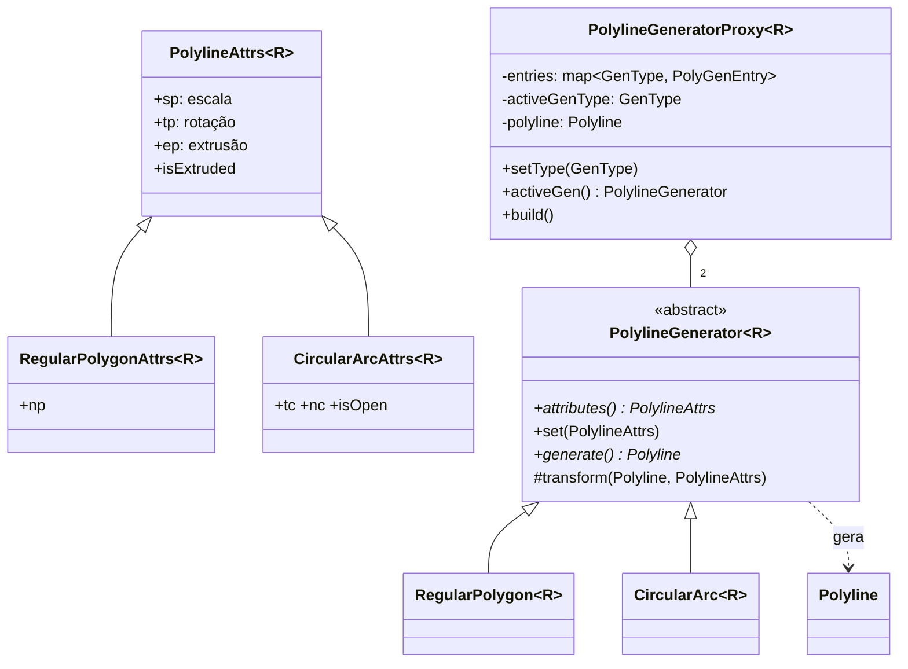
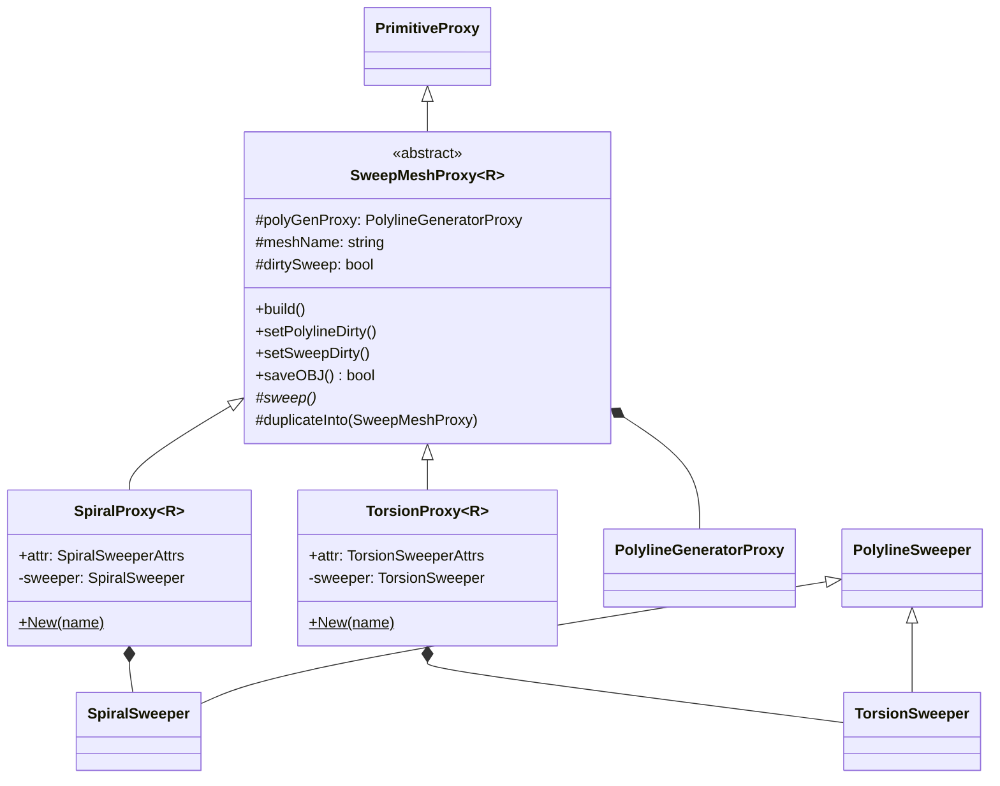
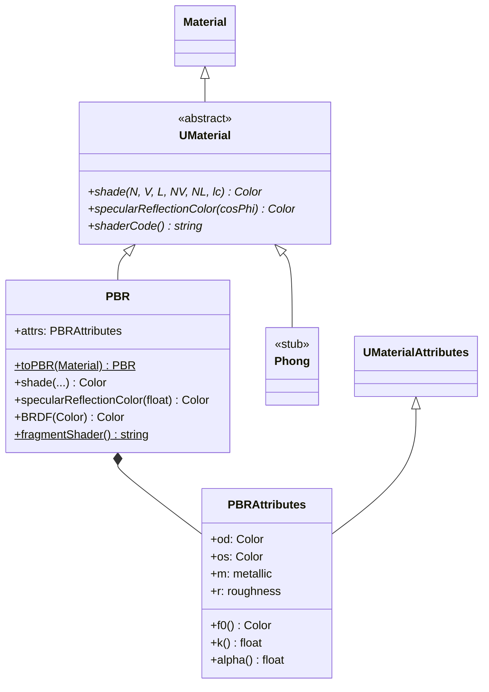
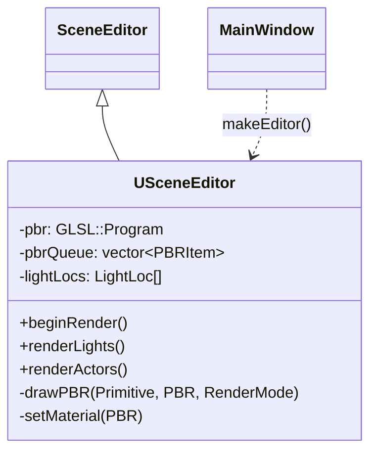

# TP: extensão do `cgdemo`

Este projeto estende o `cgdemo` com duas funcionalidades:

1. **Sweep**: malhas geradas varrendo uma polilinha (geratriz) ao longo de uma espiral ou de uma torção.
2. **PBR**: um material fisicamente baseado (Cook-Torrance) que substitui o Phong, tanto no editor (OpenGL) quanto no ray tracer.

---

## 1. Visão geral da arquitetura

```
tp/
├── include/sweep/   # polilinhas, sweepers e proxy de cena (templates)
├── include/pbr/     # UMaterial, PBR, USceneEditor
├── src/sweep/       # SweepMeshWriter (exportação .obj)
├── src/pbr/         # PBR (BRDF + shader GLSL), USceneEditor
├── reader/          # SceneReader/grammar estendidos (sweep + PBR)
├── SceneWriter.cpp  # escrita de sweep + PBR
├── RayTracer.*      # shading delegado ao material
├── MainWindow.*     # menus e inspetores novos
└── assets/scenes/   # cenas de teste (test_*.scn)
```

O núcleo do `cgdemo` (`SceneWindow`, `SceneEditor`, `PrimitiveProxy`, `Material`, `RayTracer`) é reaproveitado. As extensões entram por herança e pelos pontos de registro que o framework já oferece (`registerInspectFunction`, `registerWriteFunction`, `makeEditor`).

Fluxo de uma malha de sweep:

```
PolylineGenerator ──generate()──▶ Polyline ──sweep()──▶ TriangleMesh ──▶ TriangleMeshMapper ──▶ Editor / RayTracer
   (RegularPolygon,                 (geratriz)  (Spiral/Torsion           (mapper do proxy)          (material PBR)
    CircularArc)                                 Sweeper)
```

---

## 2. Implementação

### 2.1 Polilinhas (geratriz)

`include/sweep/Polyline.h`, `RegularPolygon.h`, `CircularArc.h`

- `Polyline<R>` guarda até 82 pontos, os limites (bounds), se é fechada e se é extrudada.
- `PolylineGenerator<R>` é a base abstrata. `generate()` produz a polilinha e `transform()` aplica os atributos comuns (escala, rotação, extrusão).
- Cada gerador tem um par **Attrs/Limits**: a struct de atributos e as constantes de mínimo/máximo usadas tanto no clamp quanto nos sliders da UI.
  - `RegularPolygon`: número de pontos `np`.
  - `CircularArc`: ângulo `tc`, segmentos `nc`, arco aberto/fechado.



`PolylineGeneratorProxy` mantém uma instância de cada gerador e sabe qual está ativo. Ao trocar o tipo (`setType`), os atributos comuns passam para o novo gerador, então escala, rotação e extrusão se mantêm. Uma flag *dirty* evita regenerar a polilinha quando nada mudou.

### 2.2 Sweepers (polilinha → malha)

`include/sweep/PolylineSweeper.h`, `SpiralSweeper.h`, `TorsionSweeper.h`

- `PolylineSweeper<R>` é a base abstrata. `sweep(polyline)` devolve uma `TriangleMesh`. A malha só recebe tampas (`capped`) quando a polilinha é fechada e não está extrudada.
- `SpiralSweeper` usa largura inicial `we`, revoluções `re`, subdivisões por volta `nes` e incrementos de altura `dh` e de largura `dw` por volta.
- `TorsionSweeper` usa comprimento `lv`, offset `(ow, oh)`, subdivisões `nsv`, escalas inicial e final `(sb, se)` e torção `rv`.
- Também seguem o padrão Attrs/Limits, com clamp dentro de `set()`.

### 2.3 Integração com o grafo de cena

`include/sweep/SweepMeshProxy.h`

O sweep vira um **componente de cena** derivado de `PrimitiveProxy`. Não deriva de `TriangleMeshProxy` porque a malha é gerada, e não carregada de arquivo.



- `build()` funciona em dois níveis de dirty: polilinha suja → regenera a polilinha → refaz o sweep. Se só os parâmetros do sweep mudaram, apenas refaz o sweep.
- `duplicate()` está implementado, então "Duplicate" na hierarquia gera uma cópia independente.

### 2.4 Interface (MainWindow)

- Novo menu **Create > Sweep Object > Spiral / Torsion**, também disponível em "Add Component".
- Inspetores registrados no construtor com `registerInspectFunction` (`inspectSpiralProxy`, `inspectTorsionProxy`).
- Os inspetores de polilinha ficam num mapa `GenType → função` (`registerPolyGenInspector`). Um novo gerador só precisa de uma entrada no mapa, sem novos `if`s.
- Cada slider marca o nível de dirty correspondente, e o proxy é reconstruído no fim do inspetor.
- O limite mínimo de `dh`/`dw` muda conforme a geratriz quando `re > 1`, para que as voltas não se sobreponham.

### 2.5 Exportação `.obj`

`include/sweep/SweepMeshWriter.h`, `src/sweep/SweepMeshWriter.cpp`

- `SweepMeshWriter::writeOBJ` grava a malha em `assets/meshes/<nome>.obj`.
- `isValidName` aceita só letras, dígitos, `_` e `-`. A UI mostra um popup de sucesso ou de erro.

### 2.6 Material PBR

`include/pbr/UMaterial.h`, `PBR.h`, `src/pbr/PBR.cpp`



- `UMaterial` define uma interface única de material, com `shade` para o ray tracer e `shaderCode` para o editor.
- A BRDF do `PBR` é Cook-Torrance: Fresnel de Schlick, geometria Smith/Schlick-GGX e distribuição GGX, somadas a um termo difuso lambertiano `(1-m)·od/π`.
- `specularReflectionColor` dá a cor da reflexão especular, aproximada em função de `cos φ` e da rugosidade. O ray tracer a usa nos raios secundários.
- `toPBR` converte um `Material` Phong legado, o que mantém a compatibilidade com cenas antigas.
- `Phong.h` e `ShaderLanguageManager.h` são esboços e ainda não são usados.

### 2.7 PBR no ray tracer

Em `RayTracer.cpp`, o `shade` funciona assim:

- O material passa a ser obrigatoriamente um `UMaterial`. Caso contrário, é lançado um erro.
- A iluminação direta delega a `m->shade(...)`, e o resultado é multiplicado por π. O termo ambiente foi removido.
- A reflexão usa `Or = m->specularReflectionColor(-NV)` no lugar de `m->specular`.
- `defaultMinWeight = 0.05` fica um pouco acima do F0 dielétrico (0,04), para cortar a recursão de reflexos pouco visíveis.

### 2.8 PBR no editor (OpenGL)

`include/pbr/USceneEditor.h`, `src/pbr/USceneEditor.cpp`, `include/pbr/Shaders.h`



- `MainWindow::makeEditor` devolve um `USceneEditor`.
- `renderActors` coloca numa fila os atores com material PBR e os desenha com o programa GLSL próprio (vertex, geometry e fragment shaders, com wireframe via geometry shader). Os demais atores seguem o caminho original.
- Primitivas criadas pela UI (`createPrimitiveObject`, sweeps, `createMaterial`) recebem um PBR novo (ouro por padrão). O material default da cena também é convertido para PBR.
- `inspectPrimitivePBR` e `inspectMaterialPBR` mostram sliders de *Metallic* e *Roughness*.

### 2.9 Leitura e escrita de cenas (`.scn`)

**Gramática** (`reader/grammar.txt`): foram adicionados `metallic`/`roughness` aos materiais e a regra `Sweep`:

```
spiral|torsion "nome" (material "m")? {
  polyline { regularPolygon ... | circularArc ... }
  <itens do spiral ou do torsion>
}
```

**SceneReader**

- Materiais: se `metallic` ou `roughness` aparecem, é criado um `PBR`. Caso contrário, o material Phong é convertido com `toPBR`, com um aviso.
- `matchPrimitive` classifica o tipo como `PRIMITIVE_BASE` (mesh) ou `PRIMITIVE_SWEEP` e despacha para `matchMesh` ou `matchSweep`. O template `parseSweep<P>` atende os dois tipos de sweep.
- Primitivas sem material recebem o material "Default PBR".
- Há novos erros: `POLYLINE_EXPECTED` e `POLYLINE_TYPE_EXPECTED`.

**SceneWriter**

- Materiais são sempre gravados como PBR (`diffuse`, `specular`, `metallic`, `roughness`).
- Sweeps não gravam a malha, só os atributos que permitem regenerá-la. `writeSpiral` e `writeTorsion` são registrados com `registerWriteFunction`, e o mapa `GenType → writer` cuida da polilinha.

### 2.10 Build e testes

- `CMakeLists.txt`: inclui os `.cpp` de `src/` e `include/` nos *include dirs*.
- `assets/scenes/test_*.scn` são cenas de teste para PBR, luzes, ray tracing, sweeps e erros de parser. O roteiro manual está em `assets/scenes/README.md`.

---

## 3. Decisões de projeto

| Decisão | Motivo |
|---|---|
| Templates `<IsReal R>` no sweep | Mantém o padrão numérico da biblioteca `cg` |
| Pares Attrs/Limits | Os mesmos limites servem ao clamp, aos sliders e ao parser |
| Mapas `GenType → função` (UI e writer) | Um novo gerador de polilinha não exige mudar `if`/`switch` |
| Dirty flags em dois níveis | Evita regenerar a malha inteira a cada frame |
| Extensão por herança e registro | O núcleo do `cgdemo` continua intacto |
| Conversão Phong → PBR | Cenas e materiais antigos continuam abrindo |
